<div align="center">

<h2>SELVİ DİLARA KAHRAMAN</h2>

<p>
	<strong>Software Developer | Yazılım Geliştirici</strong>
</p>

<p>
Güvenli, performanslı, test edilebilir ve sürdürülebilir yazılım çözümleri
</p>
<br><br>


<br>

<table>
<tr>

<td>

</td>

<td>

</td>

</tr>
</table>

</div>

---

## HAKKIMDA

Yazılım dünyasında kalıcı izler bırakan projelerin, yalnızca çalışan kodlardan değil; sağlam temeller üzerine kurulmuş mimarilerden geçtiğine inanıyorum. Geliştirme süreçlerimde güvenliği, performansı ve sürdürülebilirliği birer eklenti değil, sürecin merkezindeki vazgeçilmez prensipler olarak ele alıyorum. Özellikle C#, SQL ve nesne yönelimli programlama disiplinleriyle modern arka uç sistemleri kurguluyorum.

Yazılım geliştirme felsefemin temel taşları şunlardır:

* Mimaride Güvenlik: Tehditleri henüz tasarım masasındayken öngörmek, veri bütünlüğünü ve girdi doğrulama mekanizmalarını en baştan sıkı tutmak.
* Sürdürülebilirlik ve Temiz Kod: Karmaşıklıktan uzak, okunabilir, DRY (Don't Repeat Yourself) prensibine bağlı ve uzun vadede bakım maliyeti düşük yapılar inşa etmek.
* Performans ve Kalite: Proaktif yaklaşımla olası darboğazları önceden tespit etmek, kod tabanını test edilebilir (test-driven mindset) kılmak ve hata yönetimini sistemin geneline sağlam bir şekilde entegre etmek.

---

## TEKNİK ALANLAR

### Programlama ve Backend

* C#
* Nesne Yönelimli Programlama (OOP)
* LINQ
* Asenkron Programlama
* Exception (Hata) Yönetimi
* Girdi Doğrulama

### Veritabanı

* SQL
* İlişkisel Veritabanı Yapıları
* CRUD İşlemleri
* Sorgu Optimizasyonu
* Veri Doğrulama

### Yazılım Geliştirme

* Temiz Kod
* SOLID Prensipleri
* Tasarım Kalıpları
* Performans Optimizasyonu
* Güvenli Kodlama
* Test Edilebilir Mimari
* Hata Yönetimi ve Loglama
* Sürdürülebilir Yazılım Tasarımı

---

## PROJELER

GitHub üzerinde farklı seviyelerde yazılım projeleri, uygulamalar ve eğitim amaçlı çalışmalar geliştiriyorum.

Projelerimde özellikle şu yaklaşımı benimsemeye çalışıyorum:

**Güvenlik → Performans → Test Edilebilirlik → Sürdürülebilirlik**

Çalışma alanlarım arasında:
* C# uygulamaları
* Eğitim amaçlı yazılım projeleri
* Gerçek dünya senaryolarına yönelik uygulamalar
* Problem çözme ve algoritma çalışmaları
bulunuyor.


### STOK360 (Otomasyon):
https://github.com/SelviDilara/Stok360-Stok-Yonetim-Satis-Raporlama-Sistemi

ve daha nicesi sizleri çalışma alanımdaki repolarda bekliyor.

---

## EĞİTİM İÇERİKLERİ

C# ve yazılım geliştirme üzerine Türkçe eğitim içerikleri hazırlıyorum.

### Sıfırdan C# Eğitimi

C# öğrenmeye yeni başlayanlar için hazırladığım eğitim serisinde yalnızca kodların nasıl yazıldığını değil, **bir yazılımcının problem karşısında nasıl düşünmesi gerektiğini** de anlatıyorum.

Değişkenlerden veri tiplerine, dizilerden metotlara, kullanıcı girdilerinden uygulama geliştirmeye kadar temel C# konularını uygulamalar üzerinden ele alıyorum.


---

## Yazılım Geliştirme Yaklaşımım

Bir çözümün yalnızca çalışması benim için yeterli değil.

Bir uygulama geliştirirken mümkün olduğunca şu kriterleri dikkate alıyorum:

```text
Güvenlik
   ↓
Performans
   ↓
Test Edilebilirlik
   ↓
Sürdürülebilirlik
   ↓
Basitlik
```

Amacım, bugün çalışan ancak ilerleyen süreçte bakım maliyeti oluşturan kodlar yerine; **anlaşılabilir, güvenli ve geliştirilebilir** yazılımlar üretmek.

---

## GitHub'da Neler Bulabilirsiniz?

Bu profilde ağırlıklı olarak:

* C# projeleri
* Algoritma ve problem çözme örnekleri
* Eğitim içerikleri
* Eğitim projeleri
* Uygulama geliştirme çalışmaları
* Öğrenme ve araştırma amaçlı projeler
bulabilirsiniz.

---

## İletişim

**E-posta:**
[kahramanselvidilara07@gmail.com](mailto:kahramanselvidilara07@gmail.com)

**Github:**
https://github.com/SelviDilara

---

<div align="center">

### Güvenli · Performanslı · Sürdürülebilir Yazılım

</div>
